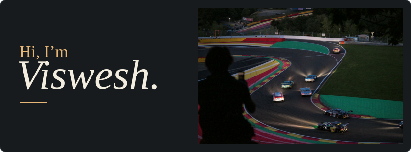
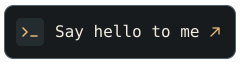

  

## A little about me

I’m a computer science student at Woxsen University in Hyderabad, India. I’m learning how AI systems look things up and how to check whether their answers are any good.

## Away from the keyboard

I watch Formula 1 from home and take photos around campus and on trips. My camera roll is mostly skies, and I drink enough coffee for it to count as a hobby.

  

  
  
  

